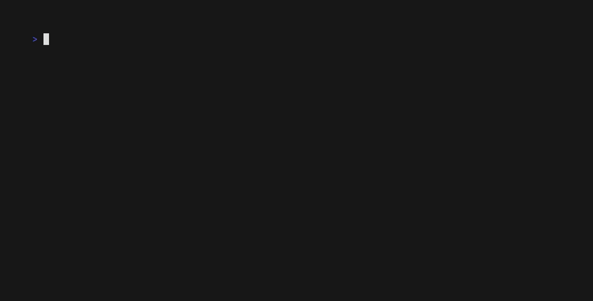
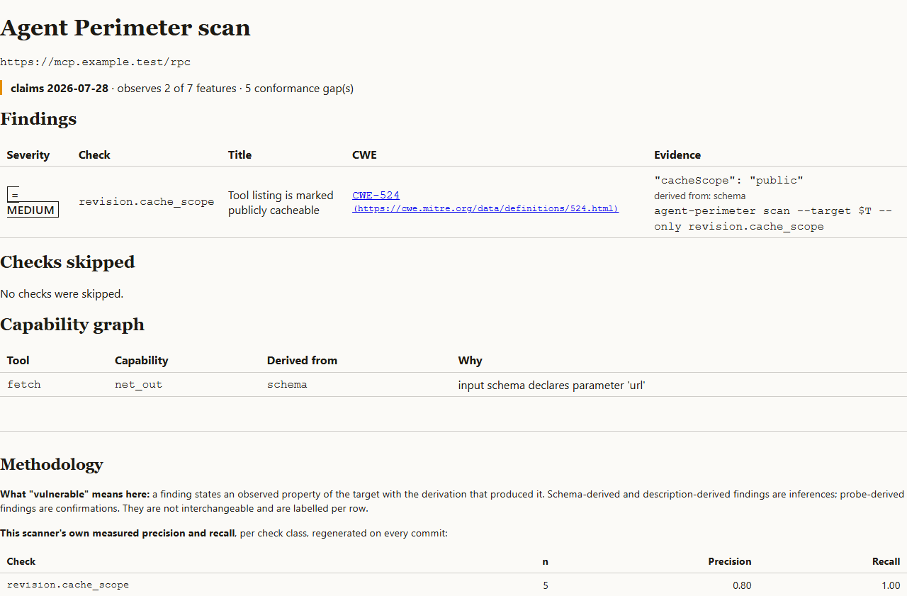
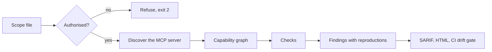

# Agent Perimeter

**Scan an MCP server or tool-using agent and get findings you can reproduce: each one carries a CWE, a published taxonomy entry, and the exact command that shows it.** Output is SARIF for GitHub code scanning, an HTML report, and a drift gate that fails CI when a tool's description changes after you approved it.



[](https://github.com/Berakhah/agent-perimeter/actions/workflows/ci.yml) [](https://github.com/Berakhah/agent-perimeter/actions/workflows/action-selftest.yml) [](https://github.com/Berakhah/agent-perimeter/releases) [](LICENSE)

**Proof point:** on 14 Sep 2026 it ran a passive census of the whole official MCP Registry (31,953 entries, 0 pagination failures). In a seeded random sample of packaged servers, 0 of 302 classifiable artifacts showed evidence of supporting MCP revision 2026-07-28 (95% Wilson CI 0.0–1.3%). `analysis/census_analysis.py` reproduces every figure from `records.csv`. [Report](docs/census/2026-09-14/census.html) · [method and caveats](docs/census/CHANGELOG.md).

## Quickstart in 60 seconds

Needs Python 3.12+ and [uv](https://docs.astral.sh/uv/). Scan an MCP server **you own or are authorised to test**:

```bash
uv tool install agent-perimeter-scan      # or: pipx install agent-perimeter-scan
agent-perimeter scan --target https://your-server.example/mcp --sarif perimeter.sarif --html perimeter.html
```

Without PyPI access, install from the release tag instead:
`uv tool install git+https://github.com/Berakhah/agent-perimeter@v1.2.1`.

Passive mode is the default. Active probes refuse to run without a [scope file](#before-you-scan-anything-the-scope-file-requirement). Stdio targets run inside a locked-down container, so they need Docker. In CI, use the [GitHub Action](#use-as-a-github-action), or copy a ready-made workflow from [`examples/`](examples/).

The HTML report (`--html`) puts each finding's evidence and reproduction command next to the capability graph and the scanner's own measured precision and recall:



## How a scan runs




## Status

What is finished: the CLI (on PyPI from 1.2.0), the GitHub Action (`v1`, tracking the newest `v1.x.y`), SARIF and HTML output, drift detection, the census pipeline, and the API and web UI behind Docker Compose.

What isn't:

- **Precision and recall are measured on the project's own 26-case fixture corpus** ([table](docs/methodology.md#measured-precision-and-recall)), where every check scores 1.00. That shows the checks do what they claim on known cases. It is not a field false-positive rate. The external MCPTox benchmark has not been run.
- **The census is passive and static.** 56% of registry entries are remote-only and have no artifact to examine, and the live-discover stratum was dropped on purpose because it could not satisfy the scope-file rule ([why](docs/census/CHANGELOG.md)).
- No bundled agent and no model calls. Injection findings prove the path exists; whether *your* agent follows it is measured only if you supply a transcript ([docs/byo-agent.md](docs/byo-agent.md)).

## How this was built

I designed it, wrote the specifications with Claude Code, set the evaluation criteria, directed the implementation, and reviewed and tested the changes. Claude Code generated a substantial part of the code under my direction. Counted on 7 Nov 2026: 248 of 259 commits were made through my second account, [@Berakhah-sys](https://github.com/Berakhah-sys), and 190 carry a `Co-Authored-By: Claude` trailer. Work started on 11 Aug 2026 in a local repository; that history was pushed here when the repository was created on 29 Aug 2026.

## Why it is different

Two things set Agent Perimeter apart from the static scanners and runtime
proxies that already exist for MCP (inventoried in
[docs/methodology.md](docs/methodology.md#competitive-claim-verification)):

1. **It proves the injection path, then measures your agent against it.**
   Where other tools flag a suspicious tool description and stop, the
   injection checks (`agent_perimeter/checks/injection/`) first prove,
   deterministically, that a path from attacker-controlled content to a
   privileged tool exists. You can then run *your own* agent against a server
   behind `agent-perimeter instrument`, which injects a canary and records the
   transcript for you, then pass it back with `--agent-transcript`
   ([docs/byo-agent.md](docs/byo-agent.md)); the finding records whether the
   agent repeated the canary in a later tool call. No agent is bundled and no
   model is called. Probes stop at reachability; nothing is weaponized.
2. **Every number it publishes can be regenerated by someone who does not
   trust it.** A vulnerable-server fixture fleet (one flaw each, plus clean
   controls), golden SARIF files, and a precision/recall table that CI
   rebuilds on every commit and fails the build on drift. Others have
   published far larger registry census figures; the ones inventoried so far
   do not ship the corpus and script needed to reproduce them.

Underneath both: explicit MCP protocol-revision negotiation with a
per-revision check matrix, a CWE and a published taxonomy entry (OWASP LLM
Top 10, OWASP MCP Top 10, CoSAI, NSA CSI, MITRE ATLAS) on every finding, and
a reproduction command a skeptic can run.

## Before you scan anything: the scope-file requirement

**An active probe against a server you do not own or have not been
authorized to test refuses to run, with no exception.** Passive checks
(static analysis of a manifest, a cloned public repo, or metadata already
returned by `tools/list`) need nothing. An active probe — anything that
sends a live request to confirm a finding — needs a scope file: `target`,
`authorising_party`, `authorised_on`, `attestation`, and optionally
`expires_on`. Without one, both the CLI and the HTTP API refuse the request
through the same authorization function (`agent_perimeter.model.scope`), not
two implementations that could someday disagree — see
`tests/api/test_refusal.py::test_the_api_and_the_cli_refuse_on_the_same_condition`.

```bash
agent-perimeter scan --target https://mcp.example.test/rpc --mode active \
  --scope-file scope.yaml
```

```yaml
# scope.yaml
target: https://mcp.example.test/rpc
authorising_party: Acme Ltd
authorised_on: 2026-09-01
attestation: "I am authorized to test this system."
expires_on: 2026-12-01
```

Run the same request over HTTP with no scope file and the API refuses it
with `422 authorization_required`, naming the missing field — never a silent
skip, never a `500`.

## Run the full stack (API + web UI)

```bash
git clone https://github.com/Berakhah/agent-perimeter.git && cd agent-perimeter
cp .env.example .env
docker compose up -d --wait
./scripts/smoke.sh
```

This brings up four things: `db` (Postgres 16), `api` (the FastAPI surface,
running pending Alembic migrations on start), and `web` (the Next.js UI) —
plus, opt-in only, `fixture`, a parameterized MCP stdio server for demos
(it is not started by a bare `docker compose up`; a stdio server has no
"healthy and listening" state the way an HTTP service does):

```bash
docker compose --profile demo run --rm fixture
```

Once `db`/`api`/`web` report healthy, the UI is at `http://localhost:3000`
and the API at `http://localhost:8000` (`GET /api/health`, `POST
/api/scans`, docs at `/api/docs`). `scripts/smoke.sh` asserts all of this
end to end, including the scope-file refusal above, and is what
`docs/evidence/clean-machine.md` records a run of.

Scanning a **stdio** target (an untrusted binary you are about to execute)
goes through the CLI, never the HTTP API, and always inside the
containerised, non-root, read-only, network-off-unless-needed launcher —
see hard constraint 4 in `CLAUDE.md`:

```bash
agent-perimeter scan --target "python /server.py" --mode passive
```

### Drift detection

A point-in-time scan cannot catch a tool whose description changes after you approved it. Snapshot once, then diff on every rescan:

```bash
agent-perimeter scan --target https://mcp.example.test --snapshot baseline.json
# … later, in CI …
agent-perimeter scan --target https://mcp.example.test --baseline baseline.json --snapshot current.json --fail-on-drift
agent-perimeter drift baseline.json current.json          # the reproduction every drift finding cites
```

Exit `3` means at least one tool's description, schema or annotations changed, or a tool appeared or vanished. The API does the same automatically: every `POST /api/scans` is compared to the previous scan of the same target, and `GET /api/scans/{id}/drift` returns the word-level diff the web drift page renders.

Exit `2` after a scan that otherwise ran means the tool listing was incomplete: a `tools/list` page failed (page 1 included), answered with no `tools` list, repeated a cursor, or hit the 100-page cap. A partial listing is never a baseline, so `--snapshot` writes nothing and `--fail-on-drift` fails closed because nothing was compared; the scan's other output (findings, `--sarif`, `--html`) is still written, and its notes name the cause. Re-run once the server answers every page; a server that answers page 1 with no `tools` list must be fixed to return `"tools": []`. A server with no tools capability, which rejects `tools/list` with Method not found (`-32601`), is not refused: its listing is complete and empty, and a note says so. The API records such a scan with `listing_complete = false` and never uses it as a baseline.

## Use as a GitHub Action

The drift recipe above as one step. On the first run there is no baseline,
so the action writes one and exits 0 — commit it. If that first scan's tool
listing was incomplete, no baseline is written and the step exits `2`; fix
the server and re-run. Every run after that
diffs against the committed file and exits `3` if any tool's description,
schema or annotations changed, or a tool appeared or vanished. Approving a
change is a commit that replaces the baseline, reviewed like any other.

```yaml
name: mcp-perimeter
on:
  push: { branches: [main] }
  schedule: [{ cron: "17 6 * * *" }]
permissions:
  contents: read
  security-events: write   # for the SARIF upload; set upload-sarif: "false" to skip it
jobs:
  scan:
    runs-on: ubuntu-latest
    steps:
      - uses: actions/checkout@v7
      - uses: Berakhah/agent-perimeter@v1
        with:
          target: https://mcp.example.test/rpc
```

| Input | Default | Meaning |
|---|---|---|
| `target` | — | URL or stdio command. May be empty when `image` is set (the image's entrypoint is the server). |
| `mode` | `passive` | `active` needs `scope-file`; the action never creates one. |
| `scope-file` | — | Authorization for active mode (see "Before you scan anything"). |
| `image` | CLI default | Container image for stdio targets. |
| `env` | — | `KEY=VALUE` per line for a stdio target. Never logged. |
| `only` | — | Run one check by id. |
| `baseline` | `.agent-perimeter/baseline.json` | Committed snapshot to diff against; written on the first run. |
| `snapshot` | `.agent-perimeter/current.json` | Where a gate run writes this scan's snapshot. |
| `fail-on-drift` | `true` | `false` keeps the job green on drift and exposes the `drift` output instead. It does not soften an exit-`2` refusal (for example an incomplete tool listing): that is not drift, and still fails the job. |
| `sarif` | `agent-perimeter.sarif` | SARIF 2.1.0 output path. |
| `html` | — | HTML report path, if wanted. |
| `upload-sarif` | `true` | Upload to code scanning. |

Outputs: `sarif-file`, `snapshot-file`, `baseline-created`, `drift`
(`none` on a first run; `true` / `false` read from the SARIF so it works with
`fail-on-drift: "false"`; `unknown` when a gate run exited non-zero without a
drift result, so no comparison can be claimed), `finding-count`. Exit codes
are the CLI's: `0` clean, `2` refused (an incomplete tool listing, active mode
without a scope file) or usage error, `3` drift gate tripped. The job summary
says why on an exit `2`. The step log's
first line is the exact `agent-perimeter scan …` command that ran, with
`env` values masked — paste it to reproduce.

Soft gate — annotate instead of fail:

```yaml
      - id: ap
        uses: Berakhah/agent-perimeter@v1
        with: { target: https://mcp.example.test/rpc, fail-on-drift: "false" }
      - if: steps.ap.outputs.drift == 'true'
        run: echo "::warning::MCP tools drifted; review ${{ steps.ap.outputs.snapshot-file }}"
```

The action installs the scanner from its own checkout (`@v1` tracks the
latest `v1.x.y` release), so a pinned action ref and the code it runs can't
disagree. [`examples/`](examples/) has a complete workflow to copy.
stdio targets run in the same locked-down container the CLI uses, on the
runner's Docker daemon — use an `ubuntu-*` runner.

## CI: SARIF in GitHub code scanning

`GET /api/scans/{id}/report.sarif` (or `agent-perimeter scan --sarif
out.sarif`) produces SARIF 2.1.0 that validates against the schema and
renders in GitHub's code scanning UI (`tests/report/test_sarif.py` is the
golden-file proof). This project's own CI (`.github/workflows/ci.yml`) is
the reference usage:

```yaml
- name: Upload SARIF sample to code scanning
  if: github.event_name == 'push'
  uses: github/codeql-action/upload-sarif@v3
  with:
    sarif_file: path/to/report.sarif
```

## What this is not

Public-registry scanning is passive only — manifests, cloned repos, static
artifacts, never a live probe against a server this project does not own
(hard constraint 2). A discovered secret is never validated against a live
service and never stored beyond its fingerprint — SHA-256 hash, entropy,
prefix, last 4 characters, file/line (hard constraint 3). Probes prove
reachability and stop; a path-traversal check reads one benign canary file
and reports the path, nothing more (hard constraint 7).

## Further reading

- **[docs/methodology.md](docs/methodology.md)** — what "vulnerable" does and
  does not mean here, the measured precision/recall table per check
  (regenerated every commit, CI fails if it goes stale), sample/population
  definitions, and every known limitation including the project's own
  measured false-positive rate.
- **The registry census report** —
  [docs/census/2026-09-14/census.html](docs/census/2026-09-14/census.html),
  first published 2026-09-14: a full census of the official MCP Registry
  (every entry, not a sample), with static artifact analysis of a seeded
  random sample of up to 200 packages per ecosystem — never a live contact
  with a third-party server. `docs/census/CHANGELOG.md` records population,
  window, sample seed, method hash and fetch failures per run;
  `analysis/census_analysis.py` reproduces every published figure from
  `records.csv` alone.
- **[docs/open-decisions.md](docs/open-decisions.md)** — the 14 design
  decisions the briefs left open (hosted vs local, registry scan scope,
  disclosure embargo, license, provider accounts, …), each closed with its
  rationale and dated.
- **[docs/security.md](docs/security.md)** — the coordinated-disclosure
  policy for findings discovered *in* servers this project scans: a 90-day
  embargo, no third-party server ever named in a published report, secrets
  reported to the owner immediately and outside embargo, aggregate
  statistics only. **[SECURITY.md](SECURITY.md)** is for vulnerabilities
  *in Agent Perimeter itself*.
- **[docs/licences.md](docs/licences.md)** — the full Python dependency
  license audit; no AGPL, SSPL, BUSL or non-commercial dependency, with
  every non-Apache/MIT/BSD dependency (all MPL-2.0 or LGPL-3.0, none
  copyleft-triggering for how this project uses them) flagged explicitly
  rather than adopted silently.
- **[docs/evidence/](docs/evidence/)** — accessibility (axe, keyboard,
  375px, print), and the compose verification record.

## License

Apache-2.0. See [LICENSE](LICENSE) and [NOTICE](NOTICE).
