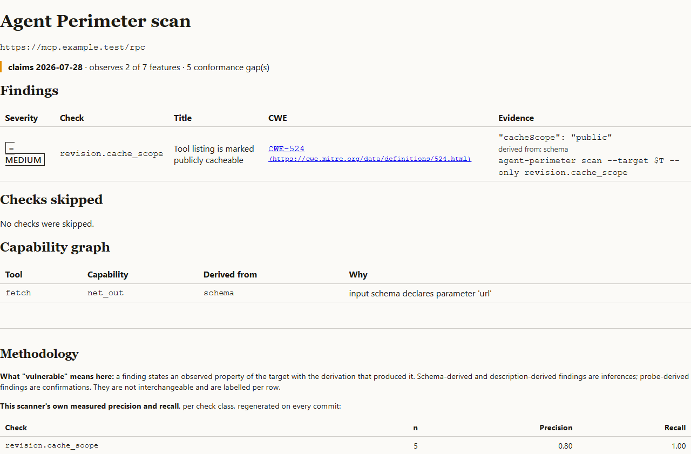

# Agent Perimeter

Scan an MCP server or tool-using agent and get findings you can reproduce. Each finding carries
a CWE, a published taxonomy entry (OWASP LLM Top 10, OWASP MCP Top 10, CoSAI, NSA CSI or MITRE
ATLAS), and the exact command that shows it. Output is SARIF 2.1.0 for GitHub code scanning, an
HTML report, and a drift gate that fails CI when a tool's description changes after you approved
it.



## Install and scan

Needs Python 3.12+. Scan a server **you own or are authorised to test**:

```bash
uv tool install agent-perimeter      # or: pipx install agent-perimeter
agent-perimeter scan --target https://your-server.example/mcp --sarif perimeter.sarif --html perimeter.html
```

- Passive mode is the default: it lists tools, resources and prompts and never calls a tool.
- Active probes refuse to run without a
  [scope file](https://github.com/Berakhah/agent-perimeter#before-you-scan-anything-the-scope-file-requirement)
  naming the target, who authorised it, and when.
- Stdio targets run inside a locked-down container (non-root, read-only root filesystem, no
  network, seccomp, memory and CPU caps, hard timeout), so they need Docker.
- Exit codes: `0` clean, `2` refused or incomplete tool listing, `3` drift gate tripped.

In CI, use the [GitHub Action](https://github.com/Berakhah/agent-perimeter#use-as-a-github-action)
or copy the [example workflow](https://github.com/Berakhah/agent-perimeter/tree/main/examples).

## What it is not

It doesn't run an agent or call a model. Injection findings show that the path exists; whether
your agent follows it is measured only if you supply a transcript. Precision and recall are
measured on the project's own fixture corpus, not in the field
([methodology](https://github.com/Berakhah/agent-perimeter/blob/main/docs/methodology.md)).

Source, issues, the full README and the MCP Registry census:
https://github.com/Berakhah/agent-perimeter. Licence: Apache-2.0.
